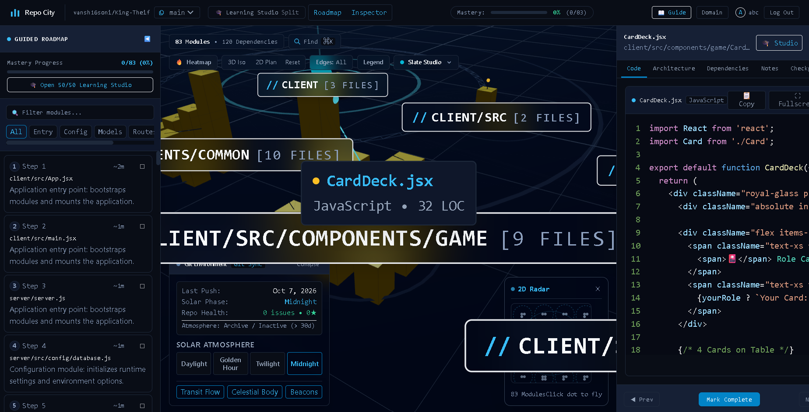

# Vansh Kumar Soni — Portfolio & Engineering Folio

> **Art-Directed Personal Website for Full-Stack Developer & Java Ecosystem Engineer**  
> Built with Swiss graphic design sensibilities, editorial typography, restrained animations, and zero generic AI templates.

---

## ✦ Design Philosophy

- **Art Direction**: Editorial web typography, asymmetric compositions, deliberate whitespace, and minimal technical aesthetics.
- **Palette**: Java & Spring Boot inspired — Charcoal (`#101510`), Spring Green (`#6DB33F`), Java Orange (`#F89820`), Warm Off-White (`#EAE9E1`), and Muted Grey (`#858B83`).
- **Typography**: Space Grotesk (Editorial Display), Inter (Body Copy), IBM Plex Mono (Technical Annotations).
- **Restraint**: Zero generic floating shapes, zero neon cyber grids, no arbitrary percentage skill bars. Every element is purposeful.
- **Privacy Safe**: Personal contact details like private phone numbers are kept completely confidential and omitted from public source code.

---

## ✦ Key Sections Included

1. **Editorial Masthead & Hero**:
   - Asymmetrical layout with dominant typographic identity, manifesto statement, and live Indian Standard Time (IST) clock.
   - **Visual Anchor**: An interactive 2D Canvas simulating an AST dependency graph and Directed Acyclic Graph (DAG) network with real-time coordinate tracking and mouse repulsion physics.
2. **Curated Case Studies (Works)**:
   - **Repo City** — 3D Codebase Visualization & AI Learning Platform (Three.js, AST Parsing, DAG algorithms, SSE, GitHub OAuth 2.0).
   - **GYAN.AI** — AI-Powered Technical Notes & Knowledge Platform (Dual-LLM Gemini ⇄ Groq fallback, React Flow knowledge graphs).
   - **ShadowPlay** — Real-Time Hand Gesture & Shadow Puppet Studio (MediaPipe Hands WASM, 21 3D landmarks, Canvas API).
   - Dedicated in-depth **Architectural Case Study Modals** for each system.
3. **Technical Profile & Architecture (Skills)**:
   - Categorized by systems: Java & Spring Boot, Full-Stack & Graphics, Applied AI & Vision, Systems & Core CSE, Persistence & Cloud.
4. **Experience Timeline**:
   - **Cisco** — AI Intern (June – August 2026, NetSage AI).
   - **BSNL** — Government Data Analytics Intern (February 2026, Telecom Churn & Revenue Optimization).
5. **Coding Practice (Technical Lab Notebook)**:
   - Interactive notebook tabs with real code excerpts and algorithms (AST cycle detection, Spring AI controller resilience, 21-landmark vector kinematics, linear regression).
6. **Development Journal**:
   - Active logs of ongoing benchmarks (Virtual Threads vs WebFlux, WebGL InstancedMesh shaders).
7. **Document Gallery & Verified Credentials**:
   - Smart India Hackathon '25 National Runner-up (top 40 finalists), Hack SRIT '24, AWS Academy credentials, SoloLearn Java.
8. **Interactive Curriculum Vitae (Resume)**:
   - Complete, verified resume dossier built directly into the site with print/PDF export and privacy protection.

---

## ✦ How to Deploy to GitHub Pages (1-Click, Concise & Zero Setup)

Because this website uses pristine, modern static web architecture, it has **zero build dependencies** and can be deployed directly to GitHub in seconds:

### Step 1: Initialize Git and Push to GitHub
```bash
git init
git add .
git commit -m "feat: initial human-art-directed portfolio"
git branch -M main
git remote add origin https://github.com/vansh16soni/vansh16soni.github.io.git
# (or use any repo name like https://github.com/vansh16soni/portfolio.git)
git push -u origin main
```

### Step 2: Enable GitHub Pages
1. Go to your repository on GitHub: `https://github.com/vansh16soni/<repo-name>`
2. Click **Settings** → **Pages** (in the left sidebar).
3. Under **Source**:
   - **Option A (GitHub Actions)**: Choose **GitHub Actions**. The included `.github/workflows/deploy.yml` will automatically build and publish your site!
   - **Option B (Deploy from branch)**: Select branch `main` and folder `/ (root)`, then click **Save**.
4. Your site will be live at `https://vansh16soni.github.io/`!

---

## ✦ How to Add Screenshots & Live Demo Links

### 1. Adding Project Screenshots
Place your screenshot files in `assets/projects/`:
- `assets/projects/repocity.png`
- `assets/projects/gyanai.png`
- `assets/projects/shadowplay.png`

In `index.html`, inside `.project-screenshot-frame`, replace the `<div class="editorial-blueprint-placeholder">...</div>` with:
```html

```

### 2. Updating Live Demo Links
In `index.html`, locate the project action row and replace the demo placeholder with your live link:
```html
<a href="https://your-live-demo-link.com" target="_blank" rel="noopener noreferrer" class="btn-primary-editorial">
  <span>LAUNCH LIVE DEMO ↗</span>
</a>
```
You can also update `demo: "https://your-live-demo-link.com"` in `js/project-modal.js` so it automatically appears inside the case study modal!

---

## ✦ Local Development & Preview

You can open `index.html` directly in any web browser, or run a local server:

```bash
# Using npx serve
npm run dev

# Or using Python
python -m http.server 3000
```
Open [http://localhost:3000](http://localhost:3000) in your browser.
